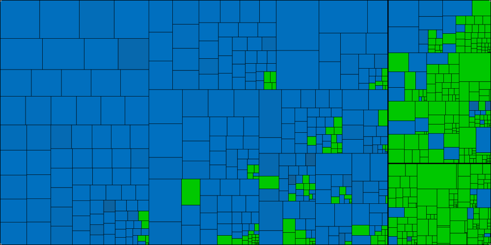
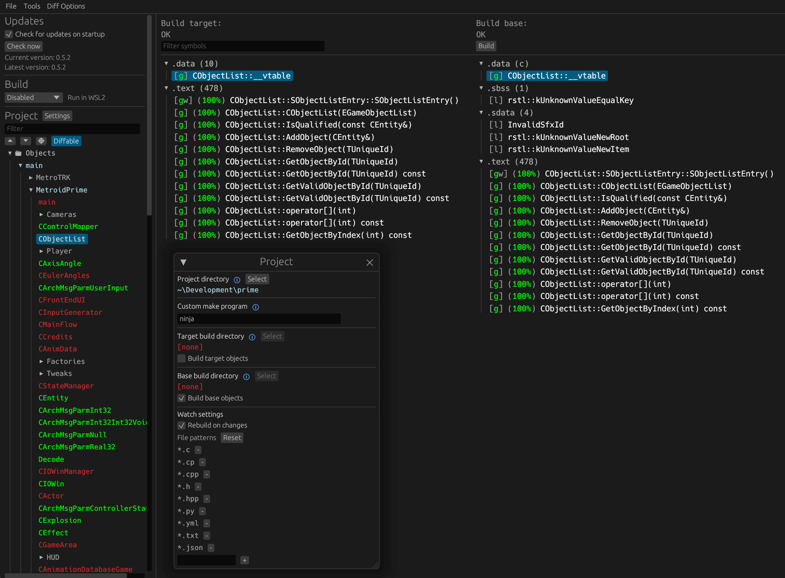

Super Mario Sunshine — US
=============

[](assets/progress.html)

Each box is one source file, sized by its code.
Green: every function matches. Blue: partly matched (brighter is closer). Dark grey: not started.
Click the graph to open the [interactive map](assets/progress.html), where each box opens that file's function list and source.
Regenerate it with `python3 tools/progress_treemap.py` after `ninja`.

<!-- progress:start -->
| | Code matched | Fuzzy | Functions matched | Units complete |
|---|---|---|---|---|
| **Total** | 52.51% | 99.11% | 10519 / 12905 | 394 / 732 |
| Game Code | 42.61% | 98.93% | 6720 / 9012 | 86 / 385 |
| JSystem Middleware | 87.17% | 99.74% | 2794 / 2878 | 167 / 198 |
| SDK Code | 95.09% | 99.89% | 1005 / 1015 | 141 / 149 |
<!-- progress:end -->


Regional target: **US** (`GMSE01`).
Configure with `python configure.py -v GMSE01`; this is also the default in this repository.
Download [the interactive map](assets/progress.html) and open it locally, or preview the SVG above.
The map is self-contained and links to this repository’s sources.

See [the comparison with the original JP 1.0 release](docs/REGIONAL_COMPARISON.md) and the [interactive reuse map](assets/reuse.html).

Upstream project: [doldecomp/sms](https://github.com/doldecomp/sms) ([upstream progress](https://decomp.dev/doldecomp/sms)).

A work-in-progress decompilation of Super Mario Sunshine.

This repository does **not** contain any game assets or assembly whatsoever. An existing copy of the game is required.

Supported versions:

- `GMSJ01`: Rev 0 (JPN)
- `GMSP01`: Rev 0 (PAL)
- `GMSE01`: Rev 0 (NTSC)
- `GMSJ01_01`: Rev 1 (JPN)
- `GMSP01_NX`: Rev 0 (Mario 3D All Stars (Switch))

Dependencies
============

Windows
--------

On Windows, it's **highly recommended** to use native tooling. WSL or msys2 are **not** required.  
When running under WSL, [objdiff](#diffing) is unable to get filesystem notifications for automatic rebuilds.

- Install [Python](https://www.python.org/downloads/) and add it to `%PATH%`.
  - Also available from the [Windows Store](https://apps.microsoft.com/store/detail/python-311/9NRWMJP3717K).
- Download [ninja](https://github.com/ninja-build/ninja/releases) and add it to `%PATH%`.
  - Quick install via pip: `pip install ninja`

macOS
------

- Install [ninja](https://github.com/ninja-build/ninja/wiki/Pre-built-Ninja-packages):

  ```sh
  brew install ninja
  ```

[wibo](https://github.com/decompals/wibo), a minimal 32-bit Windows binary wrapper, will be automatically downloaded and used.

Linux
------

- Install [ninja](https://github.com/ninja-build/ninja/wiki/Pre-built-Ninja-packages).

[wibo](https://github.com/decompals/wibo), a minimal 32-bit Windows binary wrapper, will be automatically downloaded and used.

Building
========

- Clone the repository:

  ```sh
  git clone https://github.com/doldecomp/sms.git
  ```

- Copy your game's disc image to `orig/GMSJ01`. (Or the appropriate version folder.)
  - Supported formats: ISO (GCM), RVZ, WIA, WBFS, CISO, NFS, GCZ, TGC
  - After the initial build, the disc image can be deleted to save space.

- Configure:

  ```sh
  python configure.py
  ```

  To use a version other than `GMSJ01` (JPN), specify it with `--version`.

- Build:

  ```sh
  ninja
  ```

Building a playable game
========================

The normal build only proves the match: it links the original objects for every file that is not finished, so its DOL is the retail one byte for byte.
To build the game from this repository's own source instead:

1. Do the normal setup above with your own disc image in `orig/GMSE01/`, and run `ninja` once.
2. Run `python3 tools/build_playable.py`.
   It compiles every source file, finished or not, links them, and writes `build_play/GMSE01/playable/mario.dol`.
   Files that still have little or no source are taken from the original objects split from your own disc, and the script lists them; `--pure` links only this repository's code.
3. Put that DOL into a copy of your own ISO with a GameCube ISO rebuilder, for example GCRebuilder on Windows: open your ISO (Image > Open), right-click `&&systemdata/Start.dol`, choose Import and pick the new `mario.dol`.
   If the new DOL is larger than the old one, export the whole image instead (Image > Export), replace `&&systemdata/Start.dol` in the exported folder, then open that folder as the root and rebuild a new ISO from it.
   Convert RVZ, WIA, GCZ or CISO images to ISO first, for example in Dolphin (right-click the game > Convert File).
4. Play the new ISO in Dolphin or on a console.

To share a build without sharing the game, make an xdelta patch from your own ISO, for example `xdelta3 -e -s "your game.iso" "rebuilt.iso" game.xdelta`.
Someone with the same retail disc applies it with xdelta or Delta Patcher.
A patch made without `--pure` still carries the original objects that the script listed, so only share patches built with `--pure`.

Diffing
=======

Once the initial build succeeds, an `objdiff.json` should exist in the project root.

Download the latest release from [encounter/objdiff](https://github.com/encounter/objdiff). Under project settings, set `Project directory`. The configuration should be loaded automatically.

Select an object from the left sidebar to begin diffing. Changes to the project will rebuild automatically: changes to source files, headers, `configure.py`, `splits.txt` or `symbols.txt`.


